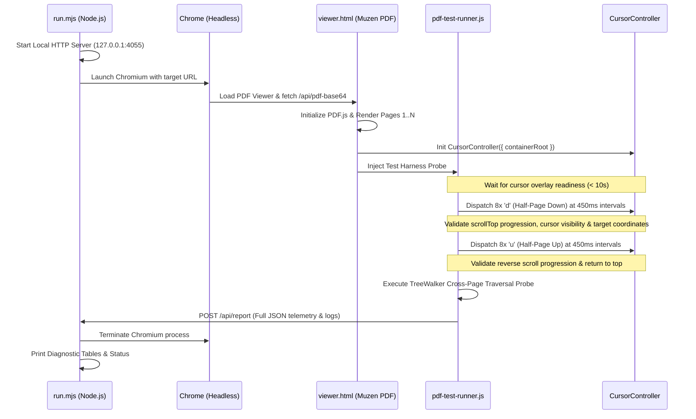

# Muzen Cursor PDF Viewer Navigation & Cross-Page Traversal Automated Test Suite (PdfTest)

> **Target Audience: AI Coding Assistants / Autonomous Development Agents**  
> This specification documents the automated headless test suite designed to verify keyboard navigation (`u` / `d` half-page jumps, `j` / `k` line steps), cross-page DOM TreeWalker penetration, and visibility state preservation in `muzen-cursor`'s continuous PDF viewer.

---

## 1. Overview & Purpose

Continuous PDF rendering environments present unique challenges compared to standard HTML web pages:
1. **Dynamic TextLayer Reconstruction**: Each PDF page renders independently within its own viewport-sized `.pdf-page-wrapper` containing an asynchronous Canvas layer and an absolute-positioned `.textLayer`.
2. **Smooth Scrolling vs. Visibility Culling**: Large vertical jumps (e.g., `d` half-page down, `u` half-page up) trigger physical damped smooth scrolls (`animateScrollTo`). If cursor coordinates are sampled before scroll completion, the target node temporarily sits outside the visual viewport, risking premature culling and false standby deactivation.
3. **Cross-Page DOM Boundary Penetration**: `createFlowTreeWalker` must traverse from the bottom of Page $N$ across Canvas and wrapper boundaries into the top of Page $N+1$ without breaking flow context or trapping the cursor.

This test suite executes programmatic end-to-end verification under real headless Chromium conditions.

---

## 2. Directory Structure

```
tests/pdf/
├── README.md               # AI Agent guidance & architectural specification (this file)
├── run.mjs                 # Node.js supervisor: starts micro HTTP server & launches Headless Chrome
├── pdf-test-runner.js      # Injected browser telemetry probe & keystroke automation harness
└── fixtures/
    └── book-riscv-rev1.pdf # MIT 6.828 xv6 RISC-V textbook (110 pages, 523 KB)
```

---

## 3. Test Fixture

- **File**: `tests/pdf/fixtures/book-riscv-rev1.pdf`
- **Origin**: [MIT CSAIL pdos.csail.mit.edu/6.828/2020/xv6/book-riscv-rev1.pdf](https://pdos.csail.mit.edu/6.828/2020/xv6/book-riscv-rev1.pdf)
- **Attributes**: 110 pages, mixed single/double-column layouts, code snippets, and structural heading hierarchy.

---

## 4. Execution Commands

Before running the test suite, ensure production bundles are built:

```bash
# 1. Build TypeScript and Vite distribution bundles
npm run build

# 2. Execute headless PDF test
npm run test:pdf
# or
node tests/pdf/run.mjs
```

---

## 5. Test Architecture & Workflow



---

## 6. Acceptance Criteria & Evaluation Metrics

Any AI agent modifying navigation algorithms, scroll damping, or visibility logic **MUST** ensure all metrics pass:

| Metric | Target / Formula | Acceptance Threshold | Physical Meaning |
| :--- | :--- | :--- | :--- |
| **1. Zero Navigation Lock (Stuck Count)** | $\text{stuckEvents} == 0$ | **PASS** | Consecutive keystrokes (`d` or `u`) must advance `scrollTop` and target coordinates. |
| **2. Active Visibility Retention** | $\text{visible} \equiv \text{true}$ | **PASS** | Cursor must not transition into inactive sleep (`visible: false`) during smooth scroll travel. |
| **3. Cross-Page TreeWalker Continuity** | `crossPageTreeWalker` $\equiv$ `PASS` | **PASS** | `TreeWalker.nextNode()` must effortlessly jump from Page $N$ bottom to Page $N+1$ top. |
| **4. Smooth Scroll Target Stability** | $\Delta\text{scrollTop} \approx 50\%\ \text{viewportH}$ | **PASS** | Physical displacement per half-page step matches container metrics without overflow. |

---

## 7. Critical Technical Notes for AI Maintenance

### A. Viewport Culling vs. Animated In-Flight Navigation
* **Root Cause of Historical Freeze**:  
  When jumping half a page, `moveHalfPage` triggers `animateScrollTo(container, targetScroll, 380)`.  
  At $t = 0\text{ms}$, `#main-content` has not yet scrolled; the new target line is physically located below the screen (`rect.top > viewportH + 80`).  
  Calling `updateCursorPosition` at $t = 0$ incorrectly flagged `isVisibleInViewport = false`, switching the cursor into standby sleep mode.  
  Because `handleKeyDown` in sleep mode previously only allowed `j` to wake up, subsequent `d` and `u` keystrokes were dropped, creating a permanent navigation freeze.
* **Invariant Rule**:  
  During programmatic in-flight navigation (`isMoving: true`), the cursor must be preserved as `forceVisible: true`. Viewport boundary culling must only apply to external, passive user mouse wheel scrolling.

### B. Scroll Container Specificity (`#main-content` vs. `window`)
* In the PDF viewer, scrolling occurs within `#main-content` (`overflow-y: auto`), **not** `window`.
* All metrics ([getViewportMetrics](file:///c:/Users/xd/DevLab/muzen-cursor/src/utils/smoothScroller.ts#L130)) must resolve against the scroll parent container, not `document.documentElement`.
